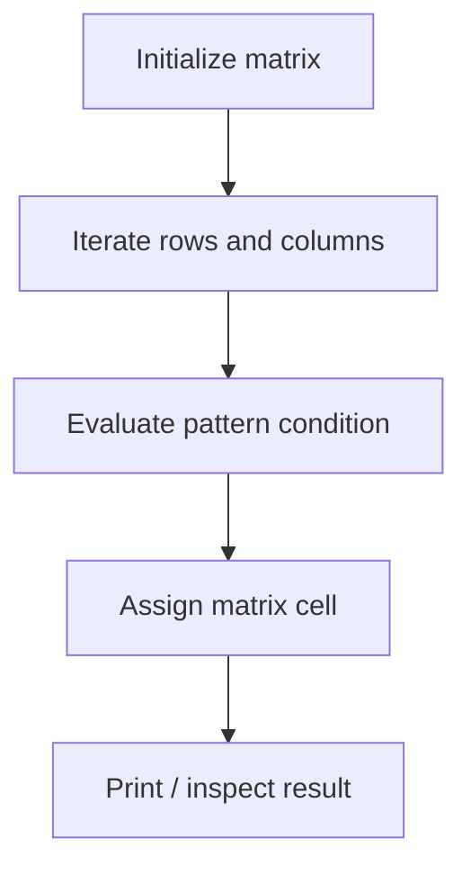

<div align="center">

# Triangle Pattern Inside a Matrix

**A focused C++ exercise in two-dimensional indexing and pattern generation.**


</div>

## Contents

- [Overview](#overview)
- [Problem focus](#problem-focus)
- [Algorithm outline](#algorithm-outline)
- [Build and run](#build-and-run)
- [Repository structure](#repository-structure)
- [Learning outcomes](#learning-outcomes)
- [License](#license)

## Overview

This repository contains a compact C++ program that generates a triangular pattern inside a matrix. It is intended as an exercise in coordinate handling, nested loops, and two-dimensional data structures.

## Problem focus

The program focuses on mapping a geometric pattern to matrix positions. The repository name also references matrix rotation, so the source should be consulted for the exact transformation and output behavior.

## Algorithm outline



This is a conceptual outline of matrix-based pattern generation, not a substitute for the implementation in `main.cpp`.

## Build and run

### Requirements

- C++ compiler

### Compile

```bash
g++ -std=c++11 -O2 -Wall -Wextra main.cpp -o matrix_pattern
```

### Run

```bash
./matrix_pattern
```

On Windows, run the generated executable from the terminal.

## Repository structure

```text
triangle_inside_matrix_rotation/
├── main.cpp
└── README.md
```

## Learning outcomes

- Matrix representation and indexing
- Nested-loop traversal
- Geometric pattern conditions
- Coordinate transformations
- C++ compilation and execution

## License

This project is licensed under the **GNU General Public License v3.0 only (GPL-3.0-only)**. You may use, study, modify, and redistribute this project under the terms of the license.

See [LICENSE](LICENSE) for the complete license text. Third-party components and assets remain subject to their own licenses and notices.
